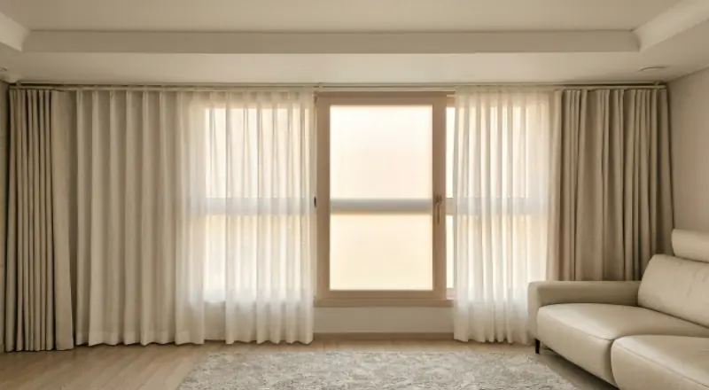
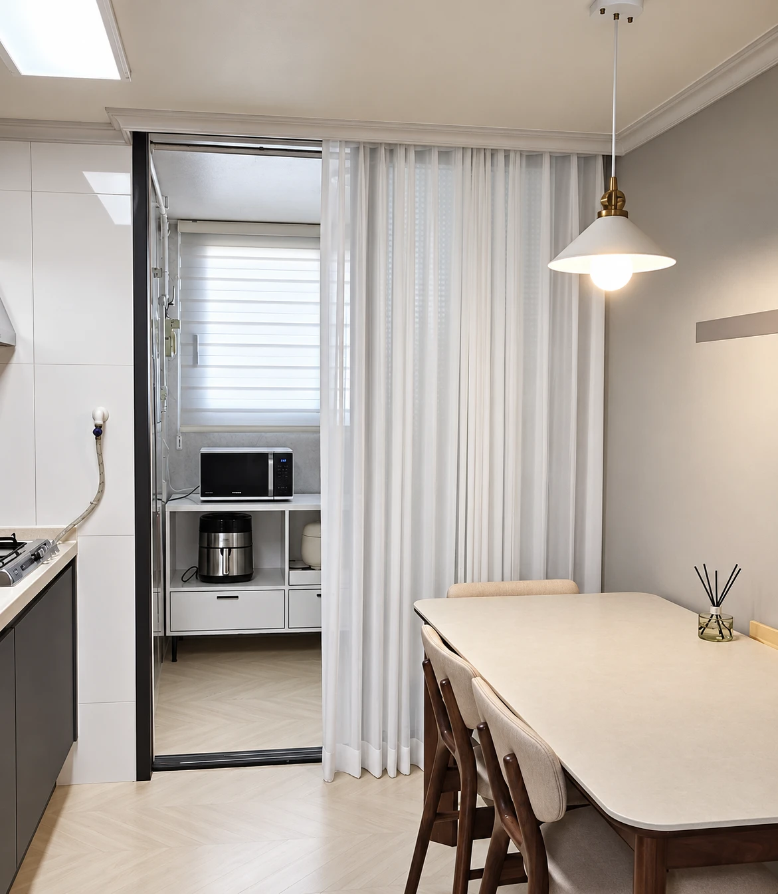
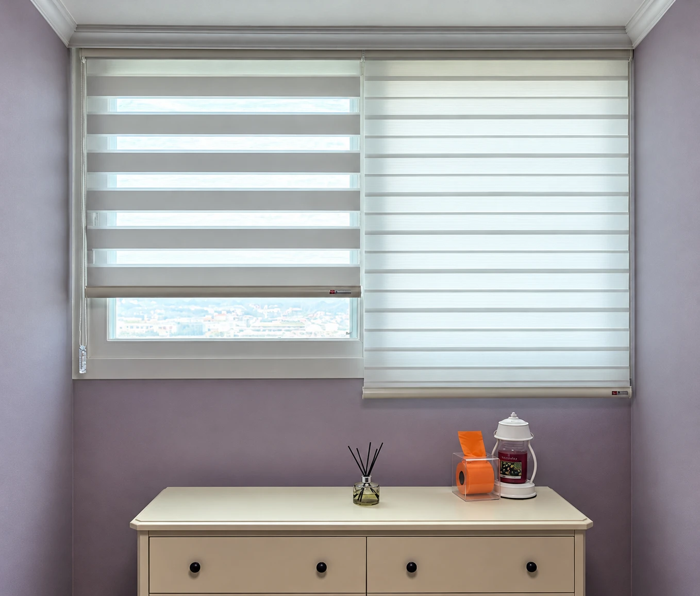

## "거실은 커튼, 주방은 블라인드" 맞는 말일까요

상담 전화를 받으면 가장 많이 듣는 질문이 이겁니다.

"저희 집은 커튼이 나을까요, 블라인드가 나을까요?"

인터넷에서는 거실은 커튼, 주방은 블라인드라고 나누기도 합니다. 하지만 **공간 이름만으로 제품을 정하기는 어렵습니다.** 주방 뒤 베란다로 자주 드나드는 집과 싱크대 앞에 작은 창이 있는 집은 필요한 구성이 다르기 때문입니다.

창 크기, 창이 바라보는 방향, 앞 건물과의 거리, 집에 아이가 있는지, 결로가 생기는 창인지. 이런 것들이 겹치면서 답이 달라집니다.

그래서 이 글에서는 "무조건 이게 좋다" 대신, **실측하러 가서 제가 실제로 여쭤보는 것들**을 정리해 보려고 합니다. 읽어 보시고 우리 집은 어느 쪽에 가까운지 가늠해 보시면 좋겠습니다.

## 먼저, 둘의 성격이 다릅니다

기능을 따지기 전에 성격 차이를 아시면 판단이 쉬워집니다.

**커튼은 원단입니다.** 천이 주름을 잡고 늘어지면서 공간을 부드럽게 만듭니다. 면적이 넓어서 색이 공간 분위기를 크게 좌우하고, 공기층을 만들어 주기 때문에 겨울철 단열에도 도움이 됩니다. 대신 자리를 차지합니다. 창 양옆으로 원단이 모이니까요.

**블라인드는 구조물입니다.** 날개나 슬랫의 각도로 빛을 조절합니다. 창에 딱 붙어 있어서 자리를 거의 차지하지 않고, 빛을 얼마나 들일지 단계적으로 정할 수 있습니다. 대신 원단만큼의 포근함은 없습니다.

한 줄로 줄이면 이렇습니다. **분위기와 단열이 중요하면 커튼, 공간 절약과 빛 조절이 중요하면 블라인드.**

여기서부터 공간별로 들어가 보겠습니다.

## 거실 — 창이 크고 바닥까지 내려온다면 커튼

거실은 집에서 창이 가장 큰 공간입니다. 면적이 넓은 만큼 여기에 무엇을 다느냐가 집 전체 인상을 정합니다.

바닥까지 내려오는 큰 창이라면 커튼을 권해 드리는 편입니다. 원단이 길게 떨어지면서 생기는 주름이 공간을 정돈해 주고, 겨울에 창에서 들어오는 냉기를 한 겹 막아 줍니다. 오창 쪽 아파트는 거실 창이 크고 베란다를 확장한 집이 많아서, 단열 얘기를 꺼내시는 분이 특히 많습니다.

거실 커튼은 **이중커튼**으로 많이 하십니다. 속커튼(시어커튼)과 겉커튼을 겹쳐 다는 방식인데, 낮에는 속커튼만 쳐서 빛은 들이고 시선은 가리고, 밤이나 잘 때는 겉커튼까지 치는 식으로 씁니다. 하루 종일 쓰는 공간이라 이 두 단계가 꽤 요긴합니다.

다만 거실에도 블라인드를 권해 드리는 경우가 있습니다.

- **창밖 전망이 좋은 집** — 원단으로 가리기 아까운 뷰가 있으면 블라인드로 시야를 살립니다
- **아이가 어린 집** — 원단이 바닥에 끌리는 게 신경 쓰이신다면 블라인드가 관리가 쉽습니다
- **거실이 좁은 집** — 커튼이 양옆으로 차지하는 폭이 부담스러운 구조가 있습니다

## 주방 — 베란다 출입과 채광부터 살펴보세요

주방은 **작은 창인지, 베란다로 드나드는 출입구인지** 먼저 확인합니다. 같은 주방이라도 사용하는 방식에 따라 어울리는 제품이 달라집니다.

주방 뒤쪽에 베란다가 있는 집에서는 **레일에 설치하는 쉬폰커튼**을 많이 선택하십니다. 빛을 부드럽게 들여 주방이 어둡게 느껴지는 것을 줄이고, 옆으로 밀어 열면 베란다를 오가기 편하기 때문입니다.

사진처럼 커튼을 한쪽으로 모으면 출입 공간을 확보하면서 베란다 안쪽 생활 공간을 필요에 따라 가릴 수 있습니다. **레일 위치, 커튼이 모이는 방향, 문을 여는 범위와 밑단 길이**를 함께 맞추는 것이 중요합니다.

다만 쉬폰은 빛이 통하는 원단이라 비침 정도가 제품마다 다릅니다. 낮과 밤의 시선 차이까지 고려해 원단을 고릅니다.

싱크대나 조리대 가까이에 있는 작은 창은 물·기름이 닿는 위치와 청소 방법을 따로 살펴봅니다. 이런 곳은 블라인드가 적합할 수 있지만, 콤비블라인드와 일반 롤스크린도 원단 제품이므로 모두 물걸레로 닦을 수 있는 것은 아닙니다. **소재별 관리법과 설치 위치를 확인한 뒤** 선택합니다.

## 침실 — 아침에 몇 시에 깨고 싶으신가요

침실에서는 이 질문 하나로 거의 정리됩니다.

**"아침 햇빛에 깨는 게 괜찮으세요, 아니면 어두운 게 좋으세요?"**

어두운 게 좋다고 하시면 **암막커튼**입니다. 빛을 거의 다 막아 주기 때문에 늦게까지 주무셔야 하는 분, 교대 근무로 낮에 주무시는 분께는 이것 말고 대안이 마땅치 않습니다. 아이 방도 낮잠 때문에 암막으로 하시는 경우가 많습니다.

햇빛에 자연스럽게 깨는 게 좋다고 하시면 굳이 암막까지 갈 필요는 없습니다. 일반 커튼이나 블라인드로도 충분합니다.

한 가지 짚어 드릴 게 있습니다. 암막커튼을 달아도 **커튼 가장자리로 빛이 새면 효과가 반감됩니다.** 창보다 넉넉하게 제작하고 레일 위치를 잘 잡아야 하는데, 이 부분은 실측 때 같이 봐 드리고 있습니다.

## 서재·작업실 — 눈부심을 잡는 게 핵심

모니터를 보는 공간이라면 기준이 하나 더 생깁니다. **화면에 빛이 반사되지 않아야** 합니다.

이때는 창 방향과 모니터 위치를 함께 보고 빛을 조절할 수 있는 제품을 고릅니다. **콤비블라인드**는 투명한 망사와 불투명한 원단 띠의 겹침을 조절해 들어오는 빛의 양을 바꿀 수 있습니다. 눈부심이 남는지는 실제 사용하는 자리에서 확인하는 것이 좋습니다.

사진처럼 창마다 내리는 높이와 원단 띠의 겹침을 달리할 수 있습니다. 실측할 때는 책상 위치와 주로 사용하는 시간대까지 살펴, 필요한 밝기와 시선 가림 정도를 함께 정합니다.

## 욕실·현관 — 물기와 크기를 보세요

욕실 창은 작고 물기가 많습니다. 원단은 피하시는 게 좋습니다. 습기를 머금으면 곰팡이가 생기기 쉽습니다.

이런 창에는 **알루미늄블라인드**나 물에 강한 소재의 롤스크린이 맞습니다. 창이 작아서 비용 부담도 크지 않습니다.

현관 옆 작은 창도 마찬가지입니다. 크기가 작으니 구조가 단순한 제품으로 가는 편이 깔끔합니다.

## 섞어 쓰셔도 됩니다

"집 전체를 통일해야 하나요?"

아닙니다. 오히려 공간 성격에 따라 나누는 게 자연스럽습니다. 거실과 주방 뒤 베란다 출입구에는 커튼을, 작은 창에는 블라인드를, 침실에는 빛 차단이 필요한 만큼의 커튼을 고르는 식입니다. 이렇게 섞는 집이 많고 전혀 어색하지 않습니다.

대신 한 가지만 지키시면 좋습니다. **색 계열을 하나로 맞추세요.** 제품 종류는 달라도 톤이 이어지면 집 전체가 정돈되어 보입니다. 거실 커튼이 아이보리라면 주방의 쉬폰커튼이나 블라인드도 어울리는 밝은 색으로 연결하는 식입니다.

## 전화로 미리 여쭤보는 것들

실측 약속을 잡기 전에 전화로 이런 걸 여쭤봅니다. 미리 생각해 두시면 상담이 빨라집니다.

- **어느 공간에 하실 건가요** — 거실만인지, 집 전체인지
- **창이 몇 개이고 대략 어느 정도 크기인가요** — 정확하지 않아도 됩니다
- **앞 건물이 가까운가요** — 사생활 보호가 얼마나 급한지 판단합니다
- **겨울에 결로가 생기는 창이 있나요** — 원단을 쓸 수 있는지가 갈립니다
- **생각하시는 예산이 있으신가요** — 그 안에서 맞출 수 있는 구성을 찾아드립니다

마지막 항목을 부담스러워하시는 분이 많은데, 말씀해 주시는 편이 서로 좋습니다. 예산을 알면 그 안에서 가장 나은 조합을 찾아드릴 수 있고, 괜히 안 맞는 제품을 보시느라 시간 쓰실 일도 없습니다.

## 그래도 헷갈리시면

여기까지 읽으셔도 애매한 집이 있습니다. 당연합니다. 창을 직접 보지 않고 글로만 정하는 데는 한계가 있으니까요.

그럴 때는 전화 주세요. 창 사진 한 장만 보내 주셔도 대략적인 방향은 말씀드릴 수 있습니다. 청주·오창·오송 지역은 **방문 실측이 무료**이니, 부담 없이 불러 주셔도 됩니다.

매장에 오시면 원단을 직접 만져 보실 수도 있습니다. 화면으로 보는 색과 실제 원단 색은 꽤 다릅니다. 특히 커튼은 면적이 넓어서 그 차이가 더 크게 느껴지니, 결정 전에 한 번 들러 보시길 권해 드립니다.
