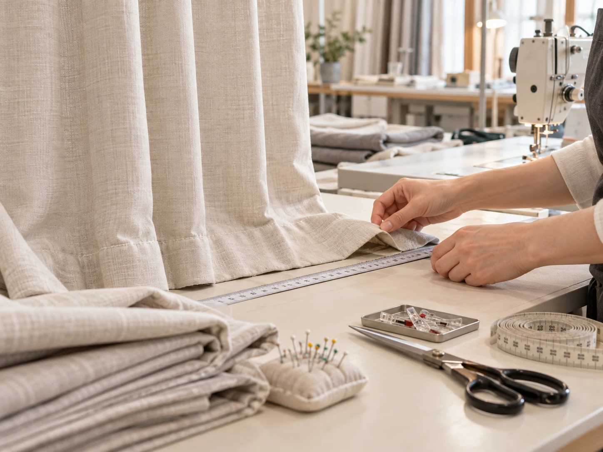
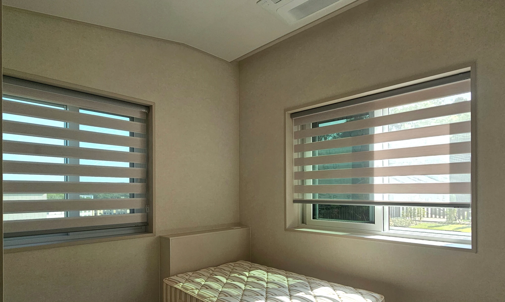

**원단에 따라 달라요.** 세탁 전에 커튼에 붙은 **케어 라벨(세탁 방법 표시)**부터 확인하세요.

쉬폰처럼 얇은 원단도 소재와 가공에 따라 물세탁 가능 여부가 달라요. 반면 암막 코팅 원단이나 형상기억 가공 커튼은 잘못 세탁하면 코팅이 갈라지거나 주름 모양이 흐트러질 수 있습니다. 블라인드는 대부분 물세탁 대신 닦아서 관리해요.

---

## 세탁 전에 꼭 확인할 3가지

**1. 케어 라벨**
물세탁 가능 여부, 손세탁 여부, 드라이클리닝 가능 여부가 표시되어 있어요. 제품 라벨과 제조사 안내를 우선하세요. 표시가 없거나 읽기 어렵다면 구매처에 확인한 뒤 세탁해 주세요.

**2. 커튼 고리·핀 분리**
분리 가능한 고리나 금속 핀은 제품 안내에 따라 빼고 세탁하세요. 원단이 찢어지거나 세탁기가 손상될 수 있어요.

**3. 원단 종류**
같은 커튼이라도 원단에 따라 세탁 방법이 달라요. 아래 원단별 안내를 참고하세요.

---

## 원단별 세탁 주의점

| 원단 | 집 세탁 | 주의할 점 |
|---|---|---|
| 쉬폰 | 라벨에서 물세탁 허용 여부 확인 | 세탁망·세탁 코스도 제품 안내에 따르기. 세게 비틀지 않기 |
| 일반 커튼 원단 | 라벨 확인 | 두꺼운 원단은 세탁기 용량 확인 |
| 암막(코팅) | 주의 | 코팅이 갈라질 수 있어 라벨 확인 필수 |
| 형상기억 가공 | 주의 | 주름 모양이 약해질 수 있음 |

**말리는 방법**
- 건조기 사용 가능 여부를 라벨에서 확인하세요. 허용 표시가 없다면 사용하지 않는 것이 좋아요. 열로 수축이나 변형이 생길 수 있습니다.
- 탈수와 건조 방식도 라벨을 따르세요. 젖은 커튼은 무거워질 수 있으므로 레일에 바로 걸어도 되는지 확인하고, 바닥·벽의 물기와 실내 환기도 살펴 주세요.

---

## 세탁 후 길이가 줄었다면?

세탁 후 커튼 기장이 짧아지는 경우가 있어요.
본대로홈은 미싱을 직접 보유하고 있어 **기장 수선을 상담**해 드려요. 다만 줄어든 길이를 늘릴 수 있는지는 밑단 여유분과 원단 상태에 따라 달라집니다. 수선 가능 여부와 비용, 소요 기간은 상태를 확인한 뒤 안내해 드립니다.

---

## 블라인드 종류별 관리법

블라인드는 대부분 통째로 세탁하지 않고 **먼지를 털거나 닦아서** 관리해요.

| 종류 | 평소 관리 | 피해야 할 것 |
|---|---|---|
| 콤비블라인드 | 부드러운 먼지떨이로 가볍게 먼지 제거 | 원단을 세게 문지르거나 물에 담그기 |
| 우드블라인드 | 마른 천으로 닦기 | 물기 (나무가 휘거나 변색될 수 있음) |
| 롤스크린 | 내린 상태에서 먼지 제거 | 원단 접기·구기기 |
| 알루미늄블라인드 | 먼지 제거 후 물기 사용이 허용된 제품만 살짝 젖은 천으로 닦고 말리기 | 연마제, 날개를 세게 눌러 변형시키기 |

위 표는 평소 먼지 관리의 참고 기준이에요. 소재·코팅과 구동 장치에 따라 관리법이 다르므로 제품 안내를 우선하고, 물이나 세제를 기계 부품에 직접 뿌리지 마세요.

주방 블라인드는 기름때가 쌓이기 쉬워요. 알루미늄블라인드나 롤스크린도 제품마다 내수성과 오염 관리법이 다르므로, 주방에 적합한 소재인지 구매 전에 확인해 주세요. → [커튼 vs 블라인드, 우리 집엔 뭐가 맞을까요?](/블로그/curtain-vs-blind)

---

## 세탁이 부담된다면, 고를 때부터 생각하세요

관리가 걱정된다면 **커튼을 고를 때 세탁 방법도 함께** 물어보세요.
본대로홈은 상담과 실측 때 원단별 관리 방법까지 안내해 드려요. 생활 방식에 맞는 원단을 함께 고를 수 있습니다.

---

## 관리가 궁금할 때도 편하게 물어보세요

세탁 방법이 헷갈리거나 수선이 필요하시면 전화로 문의해 주세요. 제품과 원단 상태를 확인해 안내해 드릴게요.

[지금 전화 상담하기](tel:050-6686-4878) · [매장에서 원단 직접 보기](/문의)

- [A/S·세탁·기장 수정 관련 FAQ](/FAQ)
- [커튼 vs 블라인드, 우리 집엔 뭐가 맞을까요?](/블로그/curtain-vs-blind)
- [청주 커튼 업체 고를 때 꼭 확인할 5가지](/블로그/how-to-choose-curtain-shop)
