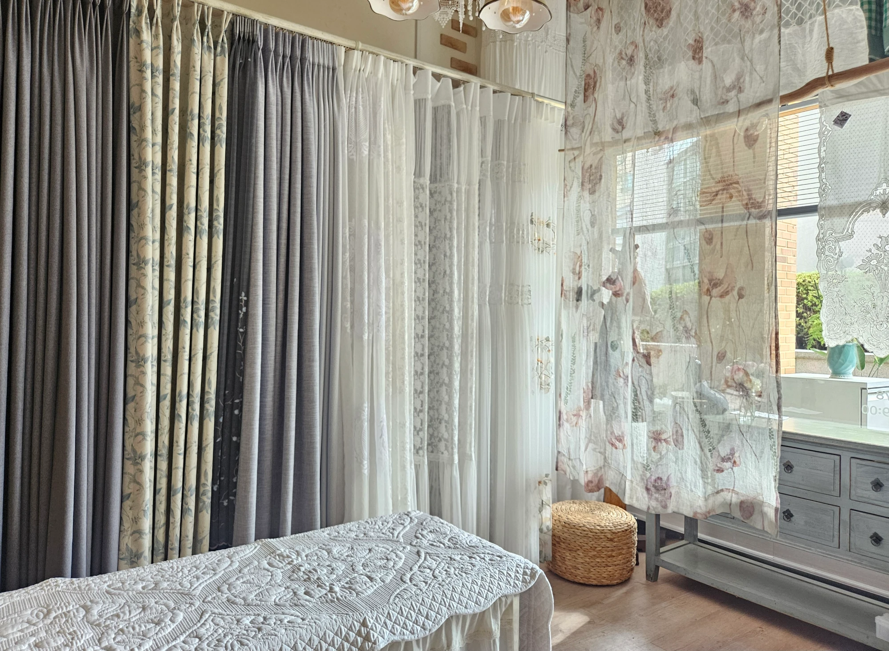
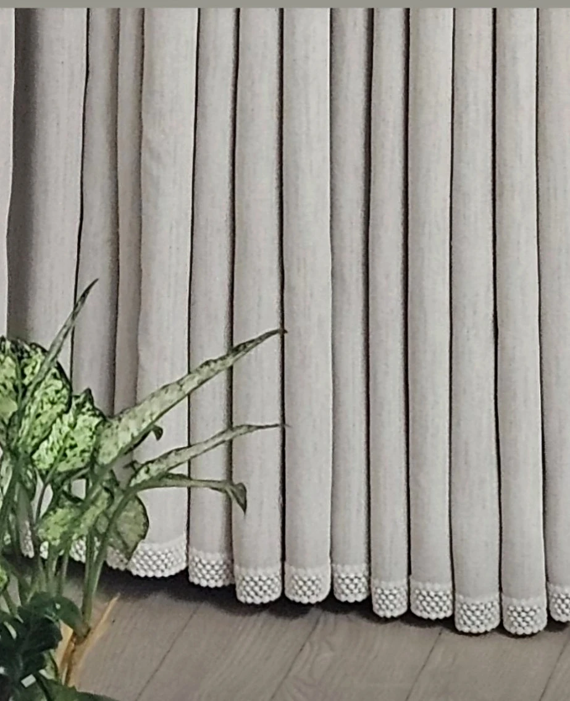

커튼 업체는 **가격만 보지 말고 다섯 가지를 함께 비교**하세요.

1. 방문 실측을 해주는지
2. 견적에 무엇이 포함되어 있는지
3. 원단을 직접 보고 고를 수 있는지
4. 설치 후 수선·A/S는 어떻게 하는지
5. 실제 시공 사례와 후기가 있는지

맞춤 커튼은 발주 후 되돌리기 어려워요. 그래서 처음 업체를 고를 때 이 다섯 가지를 확인해 두면 견적과 진행 과정에 대한 걱정을 줄일 수 있습니다.

---

## 1. 방문 실측을 해주나요?

맞춤 커튼에서 가장 흔한 문제는 **사이즈가 안 맞는 것**이에요.
"기장 잘못 나와서 두 번 방문했다"는 후기가 생기는 이유입니다.

**상담 때 물어보세요**
- 방문 실측을 해주나요? 비용이 있나요?
- 실측 때 사이즈만 재나요, 창 방향이나 인테리어도 함께 보나요?

**본대로홈은**
오창·청주·오송 지역 방문 실측이 무료예요. 실측 때 창 방향과 벽지·가구 색감까지 보고 고객님과 함께 최종 결정합니다.

→ 자세히 보기: [커튼 방문 실측, 꼭 해야 하나요? 기장 실수를 막는 방법](/블로그/why-curtain-measurement)

---

## 2. 견적에 무엇이 포함되어 있나요?

견적 금액만 비교하면 오해가 생기기 쉬워요.
업체마다 **설치비, 레일, 형상기억 가공**의 포함 여부가 다르기 때문이에요.

**상담 때 물어보세요**
- 설치비가 포함된 금액인가요?
- 레일 비용이 포함되어 있나요?
- 형상기억 가공은 기본인가요, 추가인가요?
- 실측 후 금액이 달라질 수 있나요?

**본대로홈은**
전화 상담 때 대략적인 가격 범위를 안내하고, 실측 후 정확한 견적을 드립니다. 설치비·레일·형상기억 가공의 포함 여부는 견적 상담 때 확인해 주세요.

→ 자세히 보기: [30평 아파트 거실 커튼 비용은 무엇에 따라 달라질까요?](/블로그/living-room-curtain-cost-factors)

---

## 3. 원단을 직접 보고 고를 수 있나요?

"사진으로 보는 거랑 실제로 보는 거랑 다를 것 같아요."
원단의 두께, 비침, 질감은 사진으로 확인하기 어려워요.

**상담 때 물어보세요**
- 매장에서 원단 샘플을 직접 볼 수 있나요?
- 실측 때 샘플을 가져와 실제 창에 대 볼 수 있나요?

**본대로홈은**
오창 매장에서 커튼 원단과 블라인드 샘플을 직접 만져 보고 비교할 수 있어요. 방문 실측 때 샘플 확인이 가능한지는 일정을 잡기 전에 문의해 주세요.

→ 자세히 보기: [빛은 들어오고 안은 안 비치는 커튼이 있을까요?](/블로그/light-but-not-see-through-fabric)

---

## 4. 설치 후 수선·A/S는 어떻게 하나요?

커튼은 설치 후에도 기장 조정이나 수선이 필요할 수 있어요.
이때 **공장에 다시 보내야 하는지, 업체가 직접 고칠 수 있는지**에 따라 기다리는 시간이 달라집니다.

**상담 때 물어보세요**
- 기장이 안 맞으면 어떻게 수정하나요?
- 수선은 직접 하나요, 공장에 보내나요?
- A/S 요청하면 얼마나 걸리나요?

**본대로홈은**
미싱을 직접 보유하고 있어 작은 기장 조정과 수선은 직접 해드려요. 수선 가능 범위와 비용, 소요 기간은 상태를 확인한 뒤 안내해 드립니다. A/S 기간과 적용 조건도 상담 때 확인해 주세요.

---

## 5. 실제 시공 사례와 후기가 있나요?

실제 시공 사진은 제품 선택과 마감 방식을 비교하는 데 도움이 돼요.

**확인해 보세요**
- 우리 집과 비슷한 아파트·평형의 시공 사진이 있는지
- 후기에 "무엇을, 어떻게 해줬는지" 구체적인 내용이 있는지
- 네이버 플레이스, 구글 등 여러 곳의 후기가 비슷한지

**본대로홈은**
오창·청주·오송 아파트 시공 사례를 블로그에 지역명·평형과 함께 올리고 있어요. 고객님들이 남겨 주신 후기도 문의 페이지에서 보실 수 있습니다.

"대표님과 함께 고민하고 완성해 가는 과정이 즐거웠다"는 후기처럼, 결과뿐 아니라 과정도 함께 확인해 보세요.

---

## 상담 전 체크리스트

전화 상담 때 아래 질문을 그대로 물어보시면 업체 비교가 쉬워져요.

- [ ] 방문 실측은 무료인가요?
- [ ] 견적에 설치비·레일이 포함되어 있나요?
- [ ] 매장에서 원단을 직접 볼 수 있나요?
- [ ] 기장 수정은 직접 해주시나요?
- [ ] 발주부터 설치까지 얼마나 걸리나요?
- [ ] 시공 사례를 볼 수 있나요?

---

## 본대로홈에도 편하게 물어보세요

실측부터 견적, 원단 선택과 설치 후 수선까지 궁금한 점을 하나씩 안내해 드릴게요.

[지금 전화 상담하기](tel:050-6686-4878) · [매장에서 원단 직접 보기](/문의)

- [고객 후기와 매장 위치](/문의)
- [상담부터 설치까지의 서비스 과정](/서비스과정)
- [30평 아파트 거실 커튼 비용은 무엇에 따라 달라질까요?](/블로그/living-room-curtain-cost-factors)
